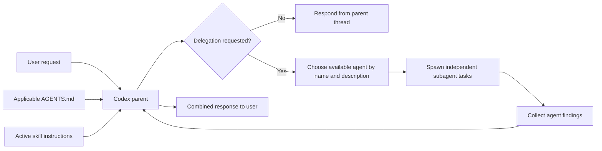
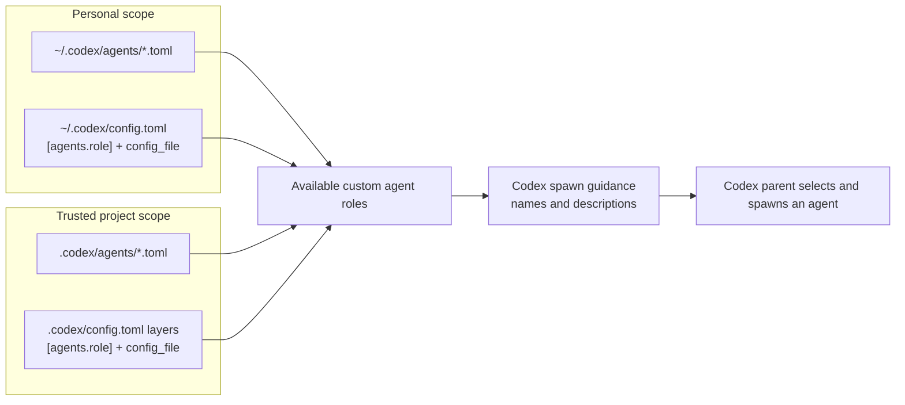

# Codex subagents

Verified against official OpenAI documentation on October 15, 2026. This document covers local Codex: the desktop app, CLI, and IDE extension.

## How Codex decides to invoke a subagent

Codex delegates when the user explicitly requests subagents or when applicable `AGENTS.md` or skill instructions request delegation. It chooses an available agent type using the task and the agent's description. Installing a custom agent makes it available; installation alone does not trigger it.

For example:

```text
Review this branch with two subagents. Have security_reviewer inspect security risks and test_reviewer identify missing coverage. Wait for both, then combine their findings.
```

### Delegation flow



Source: [Subagents — triggering workflows](https://learn.chatgpt.com/docs/agent-configuration/subagents#triggering-subagent-workflows).

## What enters the session context

Codex exposes available agent names/types and descriptions through its spawning tool's guidance, so the parent can choose an agent. The configuration reference describes an agent's `description` as guidance shown to Codex when choosing and spawning that type.

Custom agents use TOML files. Each standalone definition requires `name`, `description`, and `developer_instructions`:

```toml
name = "security_reviewer"
description = "Reviews changes for security vulnerabilities."
developer_instructions = """
Inspect the changes and report concrete security findings with file references.
Do not edit files.
"""
```

The name and description help the parent select the agent. The `developer_instructions` define the spawned agent's behavior.

Skills use a separate discovery mechanism: their initial metadata includes the name, description, and file path, and Codex reads the full `SKILL.md` when it selects the skill. A skill's `agents/openai.yaml` supplies skill metadata and policies; it is not a custom subagent definition.

Sources: [Agent configuration reference](https://learn.chatgpt.com/docs/config-file/config-reference), [custom agent schema](https://learn.chatgpt.com/docs/agent-configuration/subagents#custom-agent-file-schema), [how skills load](https://learn.chatgpt.com/docs/build-skills).

## Controlling implicit invocation

There is no supported per-agent equivalent of a skill's `allow_implicit_invocation` policy in the current custom-agent schema.

For a skill, the policy belongs in `<skill>/agents/openai.yaml`:

```yaml
policy:
  allow_implicit_invocation: false
```

This disables implicit selection of that skill while preserving explicit `$skill-name` invocation in Codex CLI and the IDE extension.

For a particular agent, express the restriction in instructions, such as an `AGENTS.md` rule:

```text
Use security_reviewer only when the user explicitly requests that agent.
```

This is an instruction for Codex to follow, rather than an enforced per-agent configuration switch. The documented setting to disable delegation entirely is in `config.toml`:

```toml
[agents]
enabled = false
```

Sources: [Skill invocation policy](https://learn.chatgpt.com/docs/build-skills#optional-metadata), [agent settings](https://learn.chatgpt.com/docs/agent-configuration/subagents#global-settings), [configuration schema](https://developers.openai.com/codex/config-schema.json).

## Where Codex reads custom agent definitions

Codex supports both personal and project-scoped standalone agent files:

| Scope | Default location |
| --- | --- |
| Personal/global | `~/.codex/agents/*.toml` |
| Project | `<project>/.codex/agents/*.toml` |

Each standalone TOML file defines one agent. The `name` field identifies the agent; matching the filename to that name is a convention.

Source: [Custom agents](https://learn.chatgpt.com/docs/agent-configuration/subagents#custom-agents).

Codex also supports role declarations in `config.toml` that reference a role-specific TOML configuration layer:

```toml
[agents.security_reviewer]
description = "Reviews changes for security vulnerabilities."
config_file = "agents/security-reviewer.toml"
```

A relative `config_file` path resolves against the configuration file that declares it. Personal configuration normally lives in `~/.codex/config.toml`. Trusted projects can supply `.codex/config.toml` layers from the repository root toward the current working directory, with closer settings taking precedence.

### Agent discovery paths



`AGENTS.md` provides instructions; custom agent registration uses the TOML definitions and configuration above.

Sources: [Role configuration reference](https://learn.chatgpt.com/docs/config-file/config-reference), [configuration discovery and precedence](https://learn.chatgpt.com/docs/config-file/config-basic).

## Using specific subagents from a skill

A skill can instruct Codex to spawn named agents. For example, a `SKILL.md` can contain:

```md
When this skill runs:

1. Spawn security_reviewer to inspect security risks.
2. Spawn test_reviewer to identify missing coverage.
3. Wait for both agents and combine their findings with file references.
```

Skill instructions are a supported delegation trigger. Register the named custom agents separately through the agent TOML locations or configuration above.

A skill does not automatically register subagents merely by containing agent files. Its `agents/openai.yaml` supports skill metadata, invocation policy, and tool dependencies. The documented dependency format supports `dependencies.tools`, not `dependencies.agents`.

To make a workflow explicitly invoked while still delegating internally:

1. Define the custom agents in `.codex/agents/` or the personal agents directory.
2. Name those agents in the skill's delegation instructions.
3. Set `policy.allow_implicit_invocation: false` in the skill's `agents/openai.yaml`.
4. Explicitly invoke the skill when the workflow is needed.

Sources: [Delegation through skill instructions](https://learn.chatgpt.com/docs/agent-configuration/subagents#triggering-subagent-workflows), [skill metadata](https://learn.chatgpt.com/docs/build-skills#optional-metadata), [supported dependency fields](https://developers.openai.com/plugins/deploy/submission-errors).
